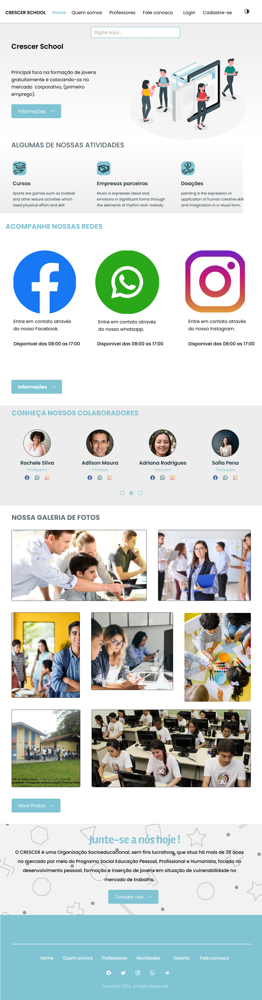

# Crescer School Website

A final-year project for CRESCER Rotary, a São Paulo nonprofit that helps young people prepare for their first jobs. The team designed a responsive website to showcase the programme and attract donors and partner companies.

> Academic design project. The original interface, report and presentation are in Portuguese.

---

## 🎓 Context

For their final project in Systems Analysis and Development at Centro Universitário Senac in 2022, Fabio Luz Moraes Pedro, Guilherme Rodrigues Faria de Andrade and Thiago Pena Silverio were asked to choose an existing nonprofit in São Paulo and create a digital portfolio for it. They chose CRESCER Rotary because of its work preparing young people for employment through free training.

The fundraising goal shaped the design brief. Prospective donors needed to understand what their support would fund, and employers needed a way to learn about the programme and get involved. The team proposed public pages about the organisation, its courses and activities, alongside portals where students could check grades and teachers could publish assignments.

## 📁 Folders

- [Prototype](Prototype/) contains 21 exported interface screens, including the [home page](Prototype/Home.png), [student grades](Prototype/Grades.png) and [teacher assignment screen](Prototype/Publish_Assignments.png).
- [Documentation](Documentation/) contains the [original project report](Documentation/Project_Report.pdf), with requirements and annotated screens.
- [Presentation](Presentation/) contains the [team slide deck](Presentation/Crescer_School_Website.pptx).

## 🛠️ Project Materials

Interface mockups, functional and non-functional requirements, and a project presentation.

## 🎖️ Features

The design covers course discovery, registration, password recovery, a student calendar, grade review and teacher assignment publishing.

---

## 🖥️ How to View

Start with the [student menu](Prototype/Student_Menu.png), then open [subjects](Prototype/Subjects.png) and [grades](Prototype/Grades.png) to follow the student journey. The screens are static PNG exports and can be viewed directly on GitHub.
