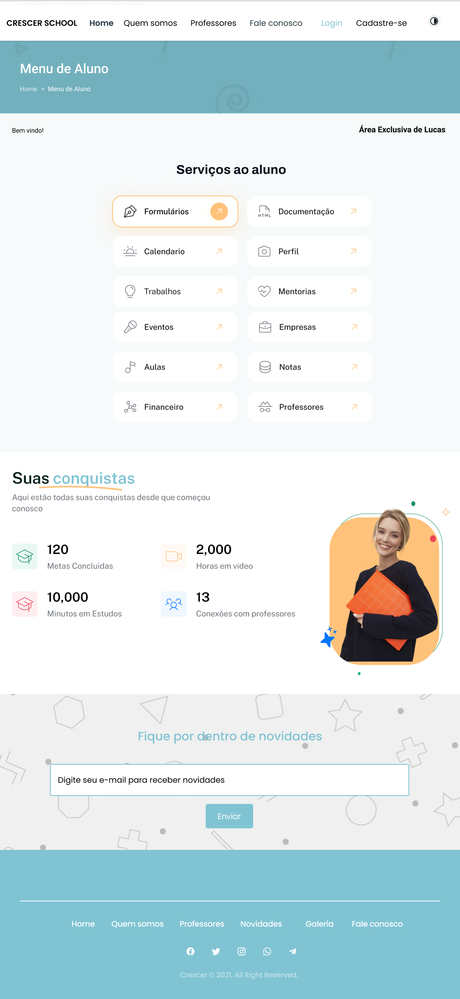

# CRESCER-SCHOOL-WEBSITE

A school website prototype connecting public course information with student and teacher portals.

> Academic design project. The original interface, report and presentation are in Portuguese.

---

**Name of the repository:** Crescer School Website

🎓 **Context**

Fabio Luz Moraes Pedro, Guilherme Rodrigues Faria de Andrade and Thiago Pena Silverio designed this prototype in 2022 for the Systems Analysis and Development course at Centro Universitário Senac. The team explored how a student could find course materials and grades, and how a teacher could publish assignments.

📁 **Folders**

- [Prototype](Prototype/) contains 21 exported interface screens, including the [home page](Prototype/Home.png), [student grades](Prototype/Grades.png) and [teacher assignment screen](Prototype/Publish_Assignments.png).
- [Documentation](Documentation/) contains the [original project report](Documentation/Project_Report.pdf), with requirements and annotated screens.
- [Presentation](Presentation/) contains the [team slide deck](Presentation/Crescer_School_Website.pptx).

🛠️ **Project Materials**

Interface mockups, functional and non-functional requirements, and a project presentation.

🎖️ **Features**

The design covers course discovery, registration, password recovery, a student calendar, grade review and teacher assignment publishing.

---

🖥️ **How to View**

Start with the [student menu](Prototype/Student_Menu.png), then open [subjects](Prototype/Subjects.png) and [grades](Prototype/Grades.png) to follow the student journey. The screens are static PNG exports and can be viewed directly on GitHub.
